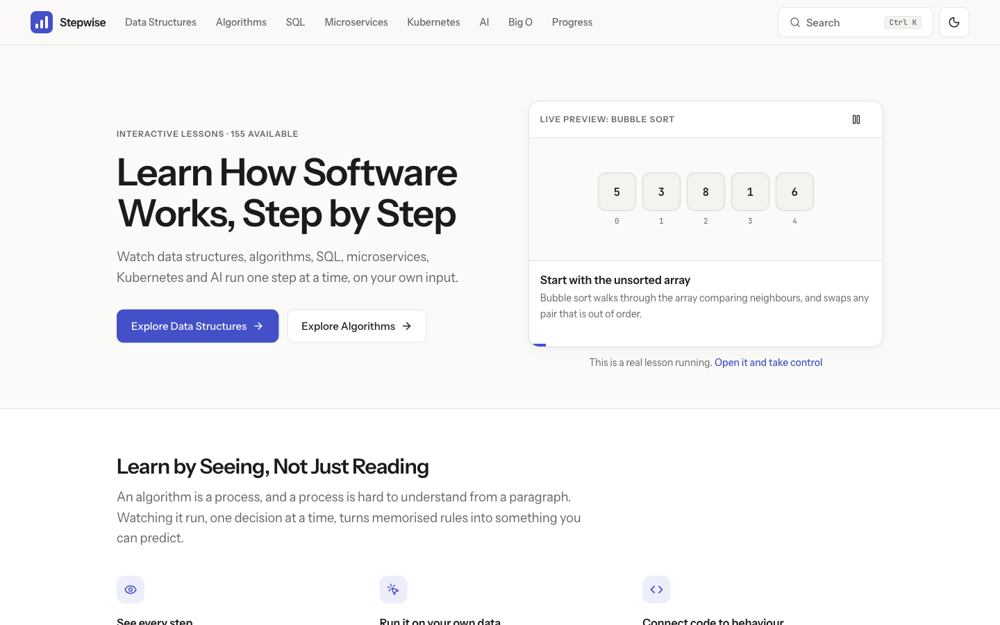

# Stepwise

An interactive platform for learning data structures, algorithms and SQL by watching them run.

Every lesson has a visualization you control: play, pause, step forward and back, change the speed, and run it on your own data. Each step explains what happened and why, and highlights the line of code responsible.



## Features

- **39 interactive lessons**
  - Data structures: Array, String, Linked List, Stack, Queue, Binary Tree, Binary Search Tree, Heap, Priority Queue, Graph
  - Algorithms: Linear Search, Binary Search, Bubble Sort, Selection Sort, Insertion Sort, Two Pointers, Sliding Window, Prefix Sum, Merge Sort, Quick Sort, Heap Sort, BFS, DFS, Topological Sort, Tree Traversal, Dijkstra, Bellman-Ford, Kruskal, Prim
  - SQL: SELECT and FROM, WHERE, NULL and three-valued logic, ORDER BY and LIMIT, DISTINCT, aggregates, GROUP BY and HAVING, INNER JOIN, LEFT JOIN, subqueries
  - Microservices: Monolith vs Microservices, Service Boundaries, Synchronous Calls, API Gateway, Service Discovery, Load Balancing, Database per Service
- **Simulated microservices**: change the settings, break an instance or a schema, and watch requests travel between services one message at a time, with each request's path, time and failure reason
- **SQL you can step through**: write any query against a sample shop or school database and watch it run clause by clause (FROM → JOIN → WHERE → GROUP BY → HAVING → SELECT → DISTINCT → ORDER BY → LIMIT), with each row the clause keeps, joins, groups or removes highlighted
- **SQL exercises** checked by comparing your result with the expected one, with hints and friendly errors that point at the line and suggest misspelled names
- **One visualization engine** for all of them: play, pause, next, previous, restart, 0.5x–2x speed, timeline scrubber, keyboard control (Space, ←, →)
- **Code and visualization in sync**: the running line is highlighted on every step
- **Your own data**: custom arrays, random data, operations on structures you build up, a choice of example graphs and start nodes
- **Quizzes** in four styles (multiple choice, complexity, code, predict the next step) with explanations and retry
- **Big O explorer**: toggle curves, change the input size, read exact operation counts, compare the course's algorithms
- **Progress tracking**: completed lessons, quiz scores, solved exercises, current lesson and a daily streak, saved in LocalStorage
- **Roadmap and full curriculum**: about 90 planned topics, shown as "Coming soon" until their lesson is written
- **Global search** with Ctrl+K (Cmd+K on macOS)
- **Light and dark themes**, responsive layout, reduced-motion support, and state cues that do not rely on colour

## Tech stack

React 19, TypeScript (strict), Vite, Tailwind CSS v4, React Router, Motion, Lucide icons, Zustand, Vitest, Oxlint.

## Getting started

Requires Node.js 20 or newer.

```bash
npm install
npm run dev
```

Then open the URL that Vite prints (normally http://localhost:5173).

## Commands

| Command | What it does |
|---|---|
| `npm run dev` | Start the development server |
| `npm run build` | Type-check, then build for production into `dist/` |
| `npm run preview` | Serve the production build locally |
| `npm test` | Run the unit tests once |
| `npm run typecheck` | Type-check without building |
| `npm run bench` | Time the SQL engine on heavy queries (`src/sql/engine.bench.ts`) |
| `npm run lint` | Lint with [Oxlint](https://oxc.rs) (config in `.oxlintrc.json`); warnings count as failures |
| `npm run build:pages` | Build for GitHub Pages under `/stepwise/` |
| `npm run check:bundle` | After a build: fail if first-load JavaScript passes 600 kB or contains lesson content |

The app uses client-side routing. When deploying the `dist/` folder, configure the host to serve `index.html` for unknown paths.

### Publishing to GitHub Pages

The site is served at https://vanmanh49.github.io/stepwise/ and publishes itself: every push to `main` runs `.github/workflows/deploy.yml`, which installs, tests, builds and deploys. You can also start it by hand from the Actions tab ("Run workflow"). If the tests fail, nothing is published. In the repository settings, Pages → Source must be set to "GitHub Actions".

`npm run build:pages` builds with the `/stepwise/` base path and copies `index.html` to `404.html`, which is how GitHub Pages serves deep links such as `/stepwise/algorithms/bfs`. If the repository is renamed, change the base path in the `build:pages` script.

## Architecture

```
src/
  types/             Step, View, Lesson and related types
  engine/            playerReducer (pure) and the usePlayer hook
  algorithms/        pure algorithms and their step generators
    sorting/  searching/  graph/
  data-structures/   step generators for structure operations
  sql/               SQL interpreter: tokenizer, parser, executor, step generator, exercise checker
    datasets/        the read-only sample databases
  microservices/     seeded discrete-event simulator, its trace-to-steps narration, one scenario per lesson
    scenarios/
  lessons/           one content file per lesson, meta/ (metadata per category), the registry and the curriculum
  store/             progress and theme state
  utils/             input parsing
  components/
    visualization/   Visualizer, controls, explanation, legend, renderers, inputs
    code/            CodePanel
    sql/             schema panel and exercises
    lesson/  quiz/  navigation/  progress/  bigo/  layout/
  pages/             Home, Catalog, LessonPage, Dashboard, BigO, NotFound
```

Rules the code follows:

- `algorithms/`, `data-structures/`, `sql/` and `microservices/` contain no React. They only produce data.
- Lesson text lives in `lessons/`, never in components.
- Components read colours from CSS variables in `src/index.css`, so both themes work everywhere.

## Visualization architecture

```
generator(input)  →  Step[]  →  usePlayer(steps)  →  <Visualizer>  →  renderer for step.view.kind
```

1. **Generator.** A pure function runs the algorithm and records a `Step` at each meaningful moment.
2. **Step.** A snapshot plus its explanation:

   ```ts
   interface Step {
     title: string;      // what happened
     why: string;        // why it happened
     next?: string;      // what happens next
     codeLine?: number;  // 1-based line in the lesson's code
     variables?: Record<string, string | number>;
     view: View;         // what to draw
   }
   ```

3. **View.** A discriminated union: `array`, `linked-list`, `stack`, `queue`, `tree`, `heap`, `graph`, `table`. Every element has a `role` such as `compare`, `swap`, `sorted` or `visited`.
4. **Player.** `usePlayer` wraps a pure reducer that owns the current index, play state and speed.
5. **Visualizer.** One shell for every lesson: stage, legend, controls, timeline, explanation and code panel.
6. **Renderers.** `StepView` picks one renderer per view kind. Role colours, border cues and marks are defined once in `components/visualization/roles.ts`.

Elements carry stable ids, so when a value changes position between two steps the renderer animates it to its new place.

## How to add a lesson

A lesson needs a generator and a data file.

1. Write the generator (see the next two sections).
2. A lesson has two parts, so pages can list lessons without downloading them:
   - **Metadata** (`id`, `title`, `category`, `difficulty`, `group`, `description`, `keywords`, `prerequisites`, `complexity`, `compareWith`): add an entry, in learning order, to `src/lessons/meta/<category>.ts`.
   - **Content**: create `src/lessons/<category>/<id>.ts` that default-exports a `LessonContent` object (`export default content;`). The file name must be the lesson's id. Copy an existing lesson as a starting point. Fill in the text, quiz and a `visualization` config:

   | `kind` | Use for | Provides |
   |---|---|---|
   | `sort` | algorithms over a number list | data field, Random, Reset |
   | `search` | list plus target | data and target fields; sorts the input when `needsSorted` is true |
   | `structure` | data structures | one button per operation; contents persist between operations |
   | `text` | structures holding text | a text field plus one button per operation |
   | `graph` | graph algorithms | example-graph and start-node pickers |
   | `sql` | SQL lessons | a query editor, "Try" examples, a schema panel and exercises (see below) |

3. There is nothing to register: `src/lessons/registry.ts` builds the lesson list from the metadata and loads each content file on demand, as its own chunk.
4. Make sure a topic with the same `id` exists in `src/lessons/curriculum.ts`. Planned topics are already listed there; registering a lesson turns "Coming soon" into a link.

Run `npm test`. `split.test.ts` checks that every metadata entry has exactly one content file and the reverse. `lessons.test.ts` checks every lesson: references resolve, the quiz is valid, the default visualization runs, and every `codeLine` points inside the lesson's code.

## How to add a SQL lesson

SQL lessons need no generator: the interpreter in `src/sql/` turns any supported query into steps.

1. Add its metadata to `src/lessons/meta/sql.ts` and leave out `complexity`; SQL lessons have no Big O section. Create the content file `src/lessons/sql/<id>.ts`, and set its `code` to the same string as `visualization.initialQuery`.
2. Fill in the `sql` config:
   - `dataset`: `'shop'` or `'school'` (see `src/sql/datasets/`)
   - `initialQuery`: shown and run when the lesson opens
   - `examples`: 3–4 `{ label, query }` buttons
   - `exercises`: 2–3 `{ id, prompt, solution, orderMatters, hint? }`. Set `orderMatters` only when the task asks for an order, and break ties in its `ORDER BY` so the order is unique.
3. For a quiz question that shows a table, use `viewAt(datasets.shop, query, index)` from `src/sql/steps.ts`; a negative index counts from the end.
4. Check the curriculum entry, as for any lesson.

`lessons.test.ts` runs every example, checks that each exercise's solution passes its own check, and requires a quiz question with a table view.

The interpreter supports `SELECT [DISTINCT]`, `FROM`, `[INNER | LEFT] JOIN … ON`, `WHERE`, `GROUP BY`, `HAVING`, `ORDER BY`, `LIMIT`/`OFFSET`, the aggregates `COUNT`, `SUM`, `AVG`, `MIN` and `MAX`, and `IN`, scalar and correlated subqueries. It follows SQLite's rules (NULL logic, integer division, column affinity, NULLs sorting first), with one deliberate exception: a column that is neither grouped nor aggregated is rejected, as most databases do. Anything else gets a clear "isn't supported here yet" error. Sample tables hold at most 20 rows, queries at most 2,000 characters, and a run at most 400 steps; longer runs summarise repeated row checks.

## How to add a microservices lesson

Microservices lessons run a simulated system in `src/microservices/`: `simulate(scenario)` plays the requests through the nodes and returns a trace, and `traceSteps` turns the trace into steps with a `services` view.

1. Write `src/microservices/scenarios/<id>.ts`, exporting:
   - `fooCode`: short pseudocode for the decision the lesson is about;
   - `fooScenario(values)`: reads the form values with `readInt`/`readChoice` and returns the scenario (nodes, links, requests, faults), or the reason the values can't run;
   - `fooSteps(values)`: `scenarioSteps(fooScenario(values), title, options)`. In `options`, `lines` maps event kinds to snippets of `fooCode`, and `explain` can change an event's wording or code line.

   Start from the shared numbers and helpers in `scenarios/shared.ts` (5 ms links, 10 ms instances).
2. Test each preset's point in `scenarios/<id>.test.ts` with `fooScenario` + `simulate`, for example which requests fail and why.
3. Add the metadata to `src/lessons/meta/microservices.ts` without `complexity`, and the content to `src/lessons/microservices/<id>.ts`: a `form` visualization with `codeLabel: 'Pseudocode'`, its fields and presets.

`src/microservices/contract.test.ts` runs every microservices lesson with random and garbage settings: each run must end with every request finished, stay within 201 steps, give valid code lines and repeat exactly.

## How to add an algorithm

1. Create a file under `src/algorithms/<group>/`.
2. Export three things:
   - the code shown to learners, as a string: `export const fooCode = \`...\``
   - the pure algorithm: `export function foo(input) { ... }`
   - the step generator: `export function fooSteps(input): Step[] { ... }`
3. In the generator, push a `Step` for each comparison, move or decision. Set `codeLine` to the matching line of `fooCode`, and write `title` and `why` in plain language with the actual values.
4. Add tests next to it. Test the pure function against a trusted reference, and test that the last step shows the final result.

Helpers worth reusing: `toCells`, `arrayView` and `swapCells` in `algorithms/sorting/cells.ts`, and `graphView` and `neighbours` in `algorithms/graph/view.ts`.

For a data structure, export a `StructureDef` from `src/data-structures/`: an initial state, a `view(state)` function, the code, and a list of operations. Each operation's `run(state, args)` returns `{ steps, state }` and must not mutate its input.

## How to add a visualization

If an existing view kind fits, there is nothing to do: return that view from your generator.

For a new kind of picture:

1. Add an interface to `src/types/visualization.ts` and include it in the `View` union.
2. Write a renderer in `src/components/visualization/renderers/`.
3. Add a `case` for it in `renderers/index.tsx`, and in `rolesInView` in `roles.ts` so the legend knows which roles it uses.

TypeScript reports every place that must handle the new kind. The engine, controls, timeline, explanation panel and code sync need no changes.

## How progress tracking works

`src/store/progress.ts` is a Zustand store persisted to LocalStorage under the key `dsa-progress`. It holds:

- `completed`: ids of completed lessons
- `quizScores`: best score per lesson
- `currentLesson`: the last lesson opened
- `activeDays`: dates on which a lesson was opened, used to compute the streak
- `exercises`: solved SQL exercises, as `lessonId/exerciseId`

A lesson is completed with the "Mark as complete" button, by a perfect quiz score, or, for SQL lessons, by solving every exercise. Stored data is validated when loaded, so corrupted or outdated data falls back to empty progress.

Components only use the store's selectors and actions (`markComplete`, `recordQuiz`, `solveExercise`, `visit`, `reset`). To move progress to a backend, replace the persistence inside this one file.

The theme is stored separately under `dsa-theme`.

## Testing

```bash
npm test
```

Unit tests cover:

- every algorithm: empty, single element, normal, duplicates, negatives, sorted, reversed and large inputs
- step generation: final state is correct, element identity is preserved, code lines are valid, step counts stay bounded
- data structure operations, including invalid ones (empty, full, out of range, missing value)
- the player reducer, input parsing, tree layout, search ranking, Big O maths and the progress store
- every registered lesson's content
- the microservices simulator (timing, faults, the gateway, registry and balancer), its narration, the services layout, and each lesson's teaching moment
- the SQL interpreter: tokenizer, parser, executor, grouping, subqueries, error messages, the step generator and the exercise checker
- **differential tests**: over 120 queries run through both the interpreter and real SQLite ([sql.js](https://github.com/sql-js/sql.js)), whose results must match. sql.js is a dev dependency used only by tests; it is never bundled into the app.

Tests run in Node without a browser. Component behaviour is checked manually in the browser.

## Working with Claude Code

The repository shares a Claude Code setup in `.claude/settings.json`. When you open the project in Claude Code and trust the folder, it offers to add the official plugin marketplace (`anthropics/claude-plugins-official`) and install these plugins:

| Plugin | Used for |
|---|---|
| `superpowers` | The spec → plan → build workflow. Specs and plans live in `docs/superpowers/` |
| `playwright` | Checking lessons in a real browser |
| `context7` | Up-to-date docs for React, Vite, Tailwind and the other libraries |
| `frontend-design` | UI and visual design work |
| `code-review` | Reviewing a branch or pull request |
| `code-simplifier` | Tidying recently changed code |

Run `/plugin` in Claude Code to see or change what is installed. Personal settings go in `.claude/settings.local.json`, which is git-ignored.
